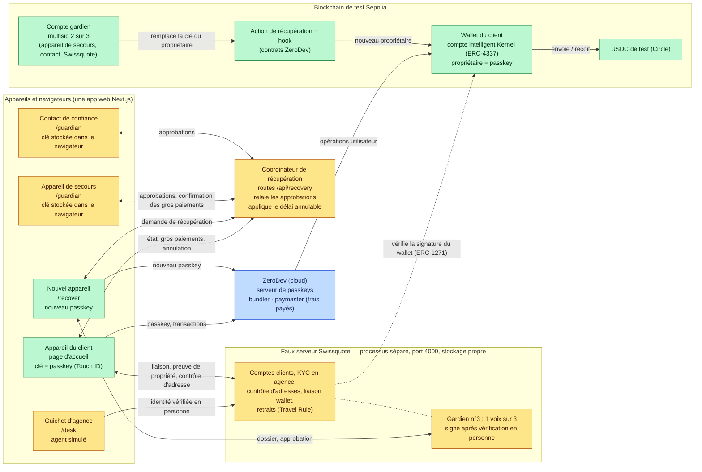
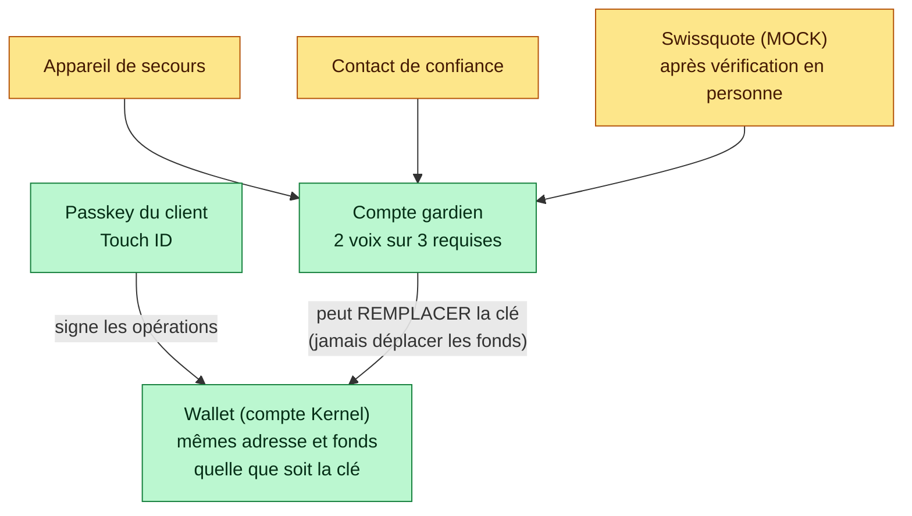
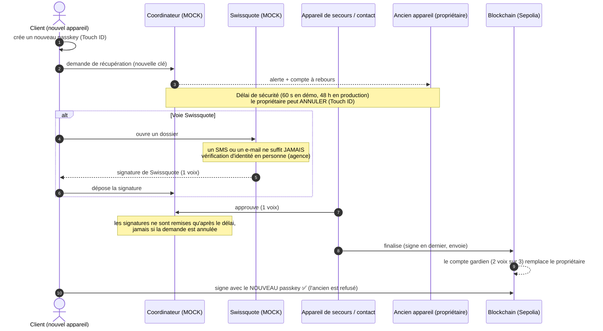
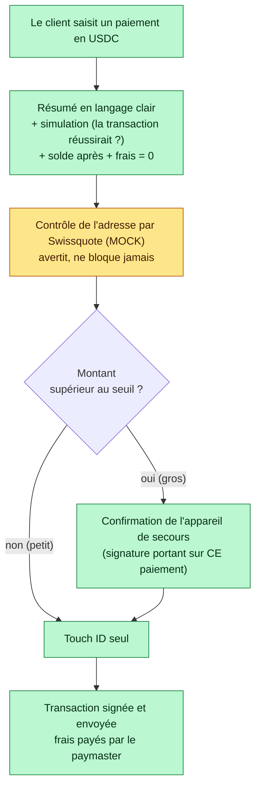
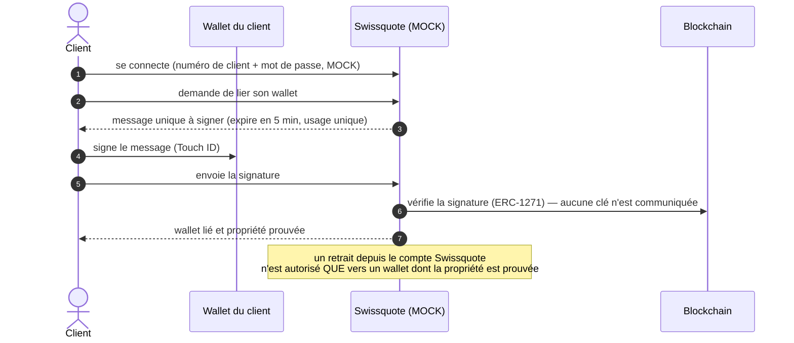

# Architecture

> Brouillon factuel. **Vert = réel** (code ou service qui fonctionne vraiment, sur la blockchain de test Sepolia). **Orange = MOCK** (simulation, clairement étiquetée dans le code et l'interface). Les schémas s'affichent directement sur GitHub (format Mermaid) ; pour les slides, on peut les exporter en image avec <https://mermaid.live> (coller le code, « PNG »).

## 1. Vue d'ensemble : qui parle à qui

**Où vivent les clés**
| Clé | Où elle est | Qui peut s'en servir |
|---|---|---|
| Clé du propriétaire (passkey) | Dans la puce sécurisée de l'appareil du client (peut être synchronisée par Apple / Google, voir `MENACE.md`) | Le client, avec Touch ID |
| Clé de l'appareil de secours | MOCK : dans le navigateur du second appareil | Le client |
| Clé du contact de confiance | MOCK : dans le navigateur du contact | Le contact |
| Clé de Swissquote (gardien) | Dans le stockage du faux serveur Swissquote (processus séparé) | Le serveur, **1 voix sur 3 seulement** |
| Clé du coordinateur | **Il n'en a aucune** | Personne : il relaie, ne signe jamais |

**Ce que Swissquote ne voit jamais** : la clé du client, ses fonds, ses paiements (sauf l'adresse destinataire pour l'avertissement). Elle ne peut rien faire seule.

## 2. Le wallet : qui contrôle quoi

La récupération **change la clé qui contrôle le wallet**. L'adresse du wallet et les fonds ne bougent pas.

## 3. Récupération (séquence)

## 4. Paiement : petit ou gros montant

## 5. Liaison au compte Swissquote et Travel Rule

## 6. Ce qui est réel, ce qui est simulé

Voir le tableau complet dans `PROJET.md` (section « Ce qui est simulé »).
