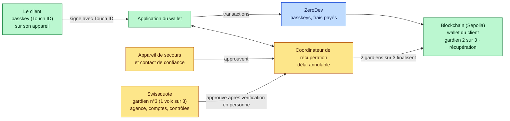
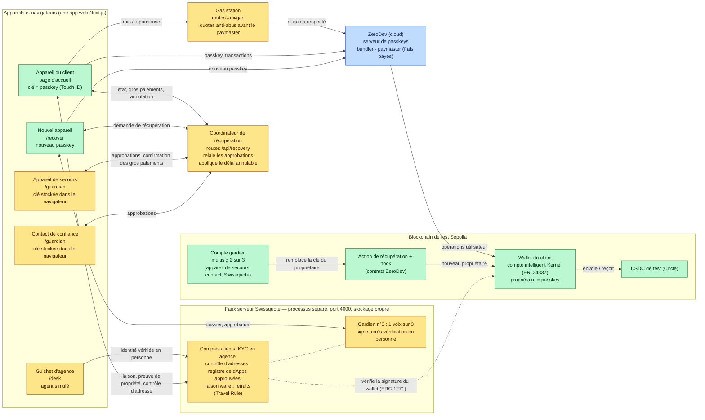
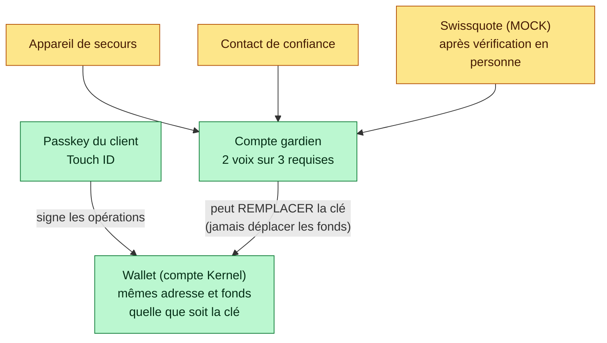
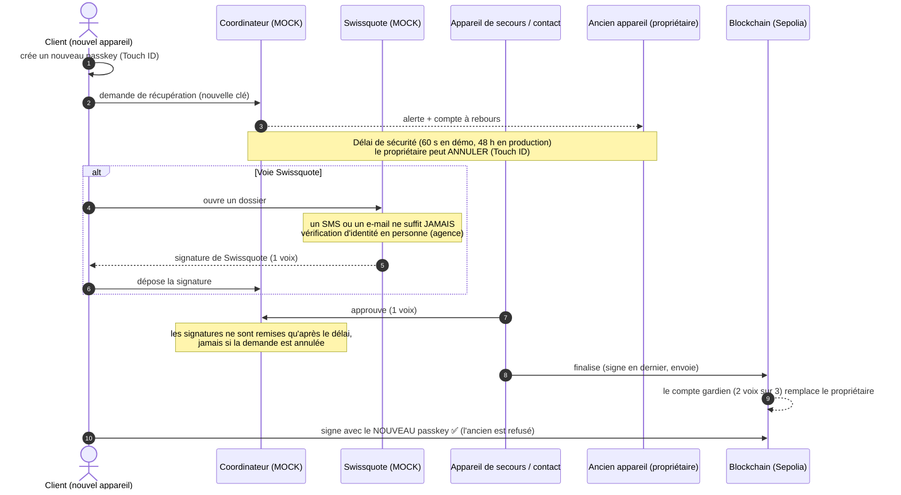
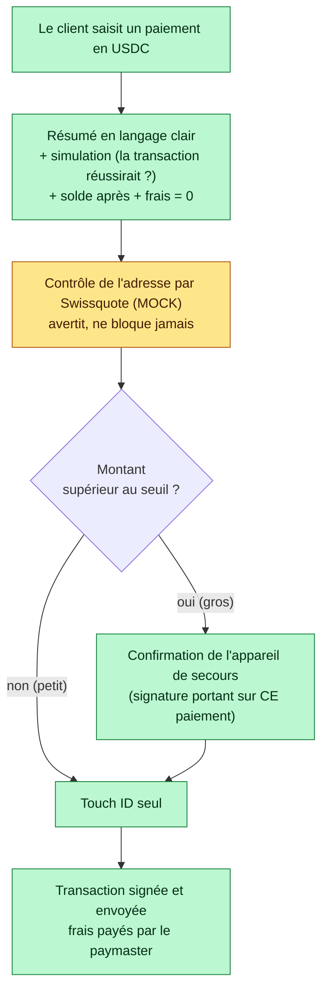
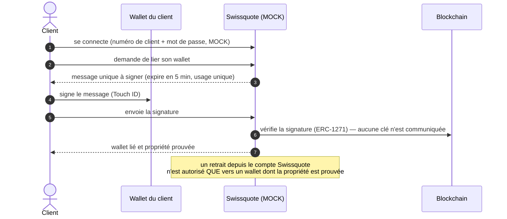
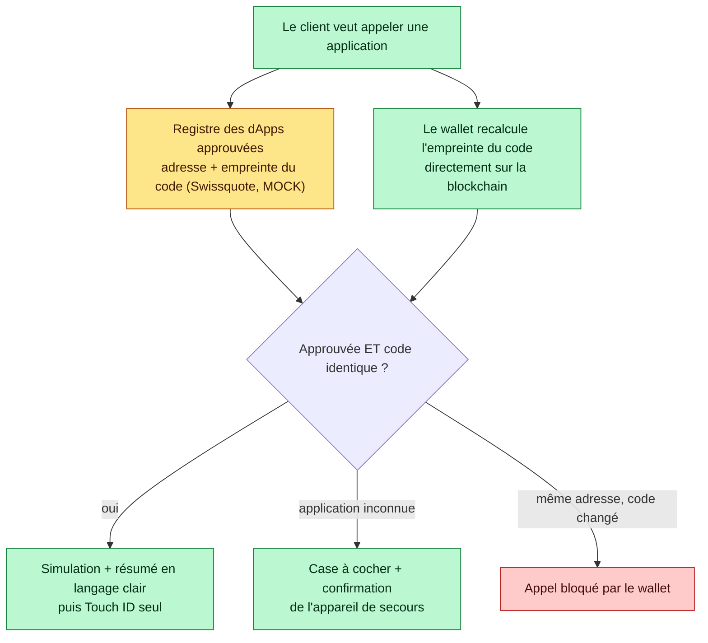
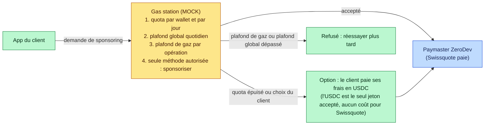

# Architecture

> Brouillon factuel. **Vert = réel** (code ou service qui fonctionne vraiment, sur la blockchain de test Sepolia). **Orange = MOCK** (simulation, clairement étiquetée dans le code et l'interface). Les schémas s'affichent directement sur GitHub (format Mermaid) ; pour les slides, on peut les exporter en image avec <https://mermaid.live> (coller le code, « PNG »).

## 0. Version pour la présentation (7 boîtes)

**En une phrase :** le client signe avec Touch ID, et s'il perd son appareil, deux gardiens sur trois (dont Swissquote seulement après une vérification en personne) font remplacer sa clé par la blockchain.

> **À mettre sur les slides.** Vert = réel, orange = simulé (MOCK), bleu = service externe. La vue détaillée est en section 1.

### Le brief de chaque boîte (pour les slides)
| Boîte | À quoi elle sert | Elle parle à |
|---|---|---|
| **Le client** | Il possède la **clé** (un passkey) dans la puce de son appareil, protégée par Touch ID. La clé n'en sort jamais. | L'application (il signe) |
| **Application du wallet** | L'écran du client : wallet, paiements, récupération, mode avancé. Elle prépare les opérations et les fait signer. | Le client, ZeroDev, le coordinateur, Swissquote |
| **Coordinateur de récupération** *(MOCK)* | Il **relaie** les demandes et les approbations entre les gardiens et **retient les signatures pendant le délai** de sécurité (le propriétaire peut annuler). Il **n'a aucune clé** et ne peut pas signer. | L'application, les gardiens, Swissquote, la blockchain |
| **Appareil de secours + contact de confiance** *(MOCK)* | Les **gardiens du client** : ils approuvent une récupération, et l'appareil de secours confirme les **gros paiements**. Clés dans le navigateur (production : passkey ou clé matérielle). | Le coordinateur |
| **Swissquote** *(MOCK, processus séparé)* | **Gardien n°3 : une voix sur trois**, donnée seulement après vérification d'identité **en personne**. Côté banque aussi : comptes clients, contrôle d'adresses, registre de dApps, preuve de propriété (Travel Rule). | Le coordinateur, l'application |
| **ZeroDev** *(service externe)* | La **technologie** du compte intelligent : serveur de passkeys, envoi des transactions, **paiement des frais** (paymaster). Il **ne peut pas signer** à la place du client. | L'application, la blockchain |
| **Blockchain (Sepolia)** | Là où vivent les **règles** : le wallet (propriétaire = passkey), le **gardien 2 sur 3**, le module de récupération, l'USDC. C'est elle qui **impose** le 2 sur 3 et refuse l'ancienne clé après récupération. | Tous, via ZeroDev |

**Comment le lire (20 secondes) :** le client signe avec Touch ID. S'il perd son appareil, **deux gardiens sur trois** (son appareil de secours, son contact, ou Swissquote après vérification en personne) approuvent, et la **blockchain** remplace sa clé. **Swissquote seule ne peut rien.**

## 1. Vue détaillée : qui parle à qui

**En une phrase :** la carte complète de tous les composants (pages, services simulés, ZeroDev, contrats) et de qui parle à qui, à garder pour répondre aux questions précises.

**Où vivent les clés**
| Clé | Où elle est | Qui peut s'en servir |
|---|---|---|
| Clé du propriétaire (passkey) | Dans la puce sécurisée de l'appareil du client (peut être synchronisée par Apple / Google, voir `MENACE.md`) | Le client, avec Touch ID |
| Clé de l'appareil de secours | MOCK : dans le navigateur du second appareil | Le client |
| Clé du contact de confiance | MOCK : dans le navigateur du contact | Le contact |
| Clé de Swissquote (gardien) | Dans le stockage du faux serveur Swissquote (processus séparé) | Le serveur, **1 voix sur 3 seulement** |
| Clé du coordinateur | **Il n'en a aucune** | Personne : il relaie, ne signe jamais |

**Ce que Swissquote ne voit jamais** : la clé du client, ses fonds, ses paiements (sauf l'adresse destinataire pour l'avertissement). Elle ne peut rien faire seule.

## 2. Le wallet : qui contrôle quoi

**En une phrase :** le client signe les paiements avec son passkey, tandis que les gardiens, à deux sur trois, peuvent seulement remplacer sa clé, jamais déplacer ses fonds.

La récupération **change la clé qui contrôle le wallet**. L'adresse du wallet et les fonds ne bougent pas.

## 3. Récupération (séquence)

**En une phrase :** après la perte d'un appareil, le client demande une récupération, le propriétaire est alerté et peut annuler pendant le délai, puis deux gardiens approuvent et la blockchain installe la nouvelle clé en refusant l'ancienne.

## 4. Paiement : petit ou gros montant

**En une phrase :** chaque paiement passe par un résumé clair, une simulation et un contrôle d'adresse, puis Touch ID seul pour un petit montant, ou Touch ID plus la confirmation d'un second appareil pour un gros montant.

## 5. Liaison au compte Swissquote et Travel Rule

**En une phrase :** le wallet signe un message unique que Swissquote fait vérifier sur la blockchain, ce qui prouve que le wallet appartient au client sans montrer de clé et autorise les retraits de la banque vers ce wallet.

## 6. Interaction avec une dApp (bonus)

**En une phrase :** avant d'appeler une application, le wallet vérifie qu'elle est approuvée par Swissquote et que son code n'a pas changé, puis bloque, freine ou laisse passer selon le résultat.

## 7. Frais sponsorisés : la « gas station »

**En une phrase :** une petite barrière limite les frais offerts par Swissquote (quota par wallet, plafond global, plafond de gaz), et au-delà le client peut payer ses frais en USDC sans coût pour la banque.

## 8. Ce qui est réel, ce qui est simulé

**En une phrase :** le tableau de ce qui est vraiment construit et de ce qui est simulé et étiqueté MOCK, pour que le jury sache exactement ce qui est démontré.

Voir le tableau complet dans `PROJET.md` (section « Ce qui est simulé »).
